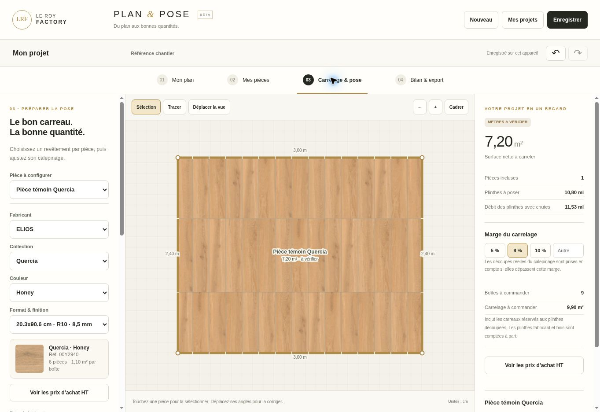

# Publication Quercia et état de reprise — 23 octobre 2026

## Résultat publié

Les huit références natives Quercia sont intégrées aux applications existantes : quatre couleurs, deux formats commerciaux, 118 faces officielles et 354 variantes sRGB. Le profil maximal conserve la définition native de 906 ou 1 200 pixels au grand côté ; il ne s’agit pas d’un agrandissement 4K.

| Application | Adresse utilisée | Source fusionnée |
| --- | --- | --- |
| RANDAL Studio One | https://studio-one-beta-test-v2.vercel.app/ | `2d21fd93f531e7c9d786f0865fa3b9c35c5e2cb9`, PR 118 |
| RANDAL Général | https://randal-catalogue-general-3d.vercel.app/ | `58926d4de40ed60f6b3f22fc2494b2ed928b5527`, PR 117 |
| LRF Plan & Pose | https://leroyfactory.fr/lrf-plan-pose.html | `58926d4de40ed60f6b3f22fc2494b2ed928b5527`, PR 117 |

Les deux arbres de code fusionnés sont identiques à ceux des builds testés : `2bef16a7ef7eb7d63ff5972b9e587387fd3d361a` pour le site/Général et `ca1a62b78b24a9e37ba2012ed28d421677f4b15c` pour Studio One.

## Préservation des travaux existants

La branche de reprise a été fusionnée avec le `main` récent, et la branche Studio avec sa branche commerce récente. Les conflits ont conservé les nouvelles textures par référence ainsi que les derniers prix des plinthes et le tarif Shell vérifié. Le catalogue Plan & Pose a été régénéré.

La comparaison des données conserve intégralement les 73 collections fabricant autres que Quercia. Seuls huit produits Plan & Pose reçoivent des champs de textures natifs ; tous les autres produits, boîtages, prix et plinthes restent identiques à la version récente. Les formats rectifiés, R11 et 40 × 120 ne reçoivent pas les faces R10 B par similarité. Aucun configurateur n’a été recréé.

## Vérifications réussies

- 73 tests Plan & Pose, dont exports natifs, mémoire, panne de texture, isolation référence/format et chiffrage des plinthes.
- 49 tests Python du pipeline. Les données synthétiques de ces tests ne sont pas présentées comme des téléchargements réels.
- Les neuf contrôles RANDAL Général et les 25 contrôles Studio One passent ; les deux compilations réussissent.
- 1 089 GET publics réels réussissent pour les 363 variantes déjà hébergées : 1 062 Quercia et 27 du pilote Creta, sur les trois origines autorisées. HTTP, WebP, CORS, octets et empreintes sont conformes.
- Les bundles `/app.js` servis par les deux adresses publiques ont exactement les SHA-256 des builds locaux testés. Les routes projets répondent 405 en GET et 401 sans session en POST ; aucune écriture de projet distant n’est effectuée.
- Le catalogue du site public fournit bien les huit références Quercia attendues.
- Dans le navigateur, une pièce de 3 × 2,4 m affiche Honey 24 × 120 en qualité légère : 30 carreaux sur 30 texturés. Le passage à Honey 20,3 × 90,6, qualité haute et rotation 90°, affiche 45 carreaux sur 45 texturés, sans erreur de chargement. Les 7,20 m² et 10,80 ml de plinthes restent cohérents.
- Le contrôle des journaux Vercel des deux ateliers ne remonte aucune erreur/fatal sur la fenêtre des quinze minutes inspectées. Cela n’est pas un essai de charge.

Le navigateur cloud ne permet pas WebGL 2, y compris sur la version précédemment publiée. Les rendus GPU des deux ateliers et les performances sur smartphone physique restent donc non vérifiés visuellement. Les tests logiques et les empreintes des fichiers ne remplacent pas ces essais.

## Publication Vercel

Les trois builds de prévisualisation sont READY. Vercel a ensuite refusé un nouveau build de production : quota `api-deployments-free-per-day` atteint (402, délai annoncé de 24 heures). La promotion par son endpoint a été refusée en 422.

Les adresses publiques existantes ont été réaffectées aux builds READY déjà testés via l’API officielle d’alias. Elles servent donc les nouveaux fichiers sans nouvelle compilation. Cette opération ne transforme pas la métadonnée `target: preview` en un nouveau build de production. Les API applicatives ne dépendent pas de secrets spécifiques à l’environnement ; leur seule branche conditionnelle Vercel vérifie la présence de la variable système `VERCEL`.

Les identifiants avant/après, la cible réelle et les arbres Git sont consignés dans `release-checks-20261023.json`. Les protections de connexion du projet n’ont pas été désactivées. Le lien temporaire utilisé pour le test de prévisualisation a été révoqué.

## Originaux restant à récupérer

La nouvelle session navigateur a ouvert le portail officiel et la connexion sécurisée au compte LE ROY FACTORY a été constatée. Le dossier Creta/MINIMALI est accessible. Un clic de téléchargement officiel sur un original de 431 Ko provoque une erreur du téléchargement et une réinitialisation du runtime. L’enregistrement direct documenté expire ensuite ; l’ouverture de l’original depuis le lien de la visionneuse est refusée par la politique de sécurité du navigateur, avec interdiction explicite de contourner ce refus. Aucune voie indirecte n’a été utilisée après ce refus.

**Aucun nouvel original n’a été récupéré ou annoncé comme téléchargé.** L’autorisation du fabricant est confirmée ; le blocage ne provient pas d’une demande de droits ou d’une absence de connexion.

| Collection | Préparation disponible | État des nouvelles textures |
| --- | --- | --- |
| Creta | 53 faces de base sur huit références R9 60 × 120 ; quatre décors séparés | Pilote de trois faces hébergé et inactif ; 50 faces de base supplémentaires restent à publier après récupération et contrôle |
| Mysterium / Magnus | 24 faces, six références LB1201–LB1206, 120 × 278, poli, rectifié, 6,5 mm | Originaux manquants ; aucune activation nouvelle |
| Deco | Six bases et 17 décors rapprochés du catalogue ; deux Original A non assignables | Originaux manquants ; aucune activation nouvelle |

Les originaux historiques Quercia/Creta ne sont pas présents dans ce nouvel espace local. Les 363 variantes publiques restent hébergées et vérifiées. Une reprise des trois lots exige leurs véritables originaux professionnels, par exemple dans une archive transmise depuis la photothèque Elios. Les contrôles de référence, format, finition, couleur, ICC, contenu et publication doivent rester en place ; les fichiers insuffisants ne doivent pas être activés pour compléter artificiellement une collection.

Aucun identifiant de connexion, mot de passe, cookie, lien privé d’original ou lien d’accès temporaire actif n’est enregistré dans le code ou ces rapports.
