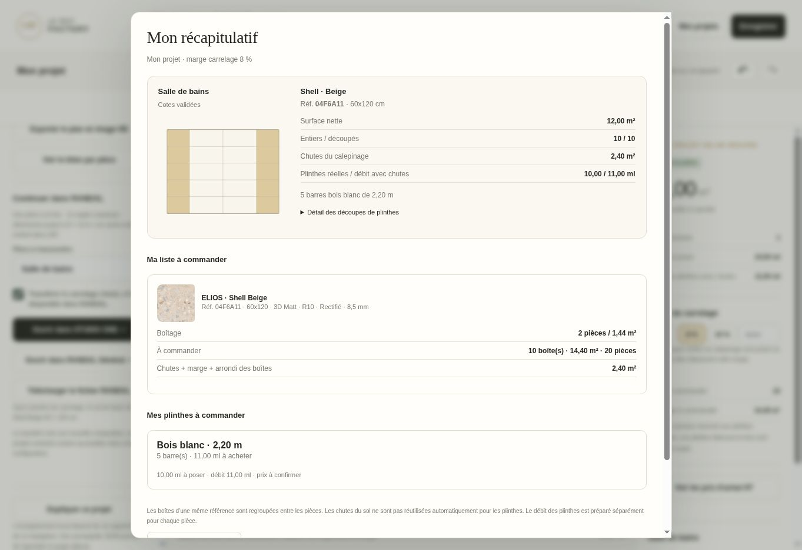

# Catalogues, plinthes et récapitulatif - 22 octobre 2026

## Parcours livré

PLAN & POSE propose un carrelage par fabricant, collection, couleur, format et finition. Les références et boîtages disponibles sont repris des données ELIOS et VIEW du site. Les achats HT sont masqués au démarrage et affichés par un bouton. Un tarif détail et un tarif palette sont distingués lorsqu'ils existent ; le chiffrage utilise le détail. Aucun achat HT n'est transformé en prix TTC.

Le passage à Bilan & export ouvre directement le récapitulatif : aperçu du calepinage, référence, boîtage, surface, carreaux entiers et découpés, chutes, boîtes et quantités à commander. Les mêmes références sont regroupées entre les pièces avant l'arrondi des boîtes. Les valeurs inconnues restent « à confirmer ».

Le catalogue généré contient 1 204 variantes, dont 948 avec référence, 1 017 avec conditionnement et 958 avec achat HT disponible, plus 114 références de plinthes ELIOS. LA FENICE conserve ses 49 liens de collections ; ses données commerciales non structurées restent à saisir. Les formats hexagonaux ne sont pas proposés comme rectangles dans PLAN & POSE.

## Plinthes

- Découpe dans les carreaux du sol, plinthes du fabricant lorsque renseignées, ou bois blanc en barres de 2,20 m.
- Sélection de chaque mur ; par défaut tous les murs sauf ceux avec faïence au niveau du sol. Un choix manuel est conservé et peut être réinitialisé.
- Les ouvertures au sol sont retirées par union d'intervalles, sans compter deux fois des ouvertures superposées. Une fenêtre haute ne retire rien.
- Les faces et retours exposés des cloisons sont comptés ; les contacts avec l'enveloppe ne le sont pas.
- Linéaire réel, débit avec chutes et quantité à acheter sont distincts. Les coupes des plinthes carrelées suivent les joints effectifs du calepinage. Les réglages avancés permettent de modifier la hauteur, le trait de coupe et la réserve.
- Le débit propose un rangement décroissant avec réemploi des chutes compatibles, sans garantie d'optimalité. Les chutes du sol ne sont pas présumées réutilisables en plinthes. Les débits de pièces différentes restent séparés.
- Les carreaux réservés aux plinthes découpées sont ajoutés au besoin de carrelage avant l'arrondi des boîtes. Les références de plinthes du fabricant sont arrondies à leur conditionnement ; le bois est compté en barres.

Les mêmes calculs, choix de murs et sauvegardes sont intégrés aux sources de STUDIO ONE et RANDAL Général. Le transfert PLAN & POSE conserve le type de plinthe, les exclusions et la phase du calepinage dans les deux sens de pose, droite ou décalée.

## PDF et confidentialité d'affichage

Le PDF reprend le plan, les métrés et la liste à commander. Les achats HT en sont exclus par défaut ; une case explicite permet de les inclure. Une police intégrée garantit des chiffres et accents lisibles. Le masquage par bouton est un choix d'affichage, pas un nouveau système d'authentification.

## Vérifications

- 55 tests Node : conversion et unités existantes, données commerciales, calculs de plinthes, faïence, portes, bois 2,20 m, conditionnement fabricant, regroupement, sauvegarde et transfert.
- Parcours DOM réel : prix masqués/révélés, modification des murs, maintien des options ouvertes, récapitulatif et choix PDF.
- Chrome à 390 px : réglages et récapitulatif contrôlés dans un cadre mobile, sans débordement horizontal observé.
- Chrome, projet de contrôle 4 x 3 m : sélection Shell Beige 04F6A11, 2 pièces / 1,44 m² par boîte ; exclusion du mur 1 avec faïence ; 10 ml posés / 11 ml de débit, soit 5 barres bois ; récapitulatif et génération du PDF vérifiés. Le téléchargement final n'a pas été confirmé par l'API du navigateur.
- Deux PDF de trois pages générés et contrôlés, avec et sans achat HT. Police intégrée, références et boîtage vérifiés ; pages rendues pour contrôle visuel.
- Builds et vérifications propres aux deux moteurs. Le navigateur de contrôle ne fournit pas WebGL : le rendu 3D final n'a pas été vérifié visuellement. Les tests natifs portent sur la géométrie et les contrôleurs, sans simuler une validation GPU.

Les nouvelles fonctionnalités des configurateurs de fabricants externes (Roomvo, RANDAL Studio fabricant, Biopietra, Reviglass) nécessitent leurs propres accès/API. Ces services tiers ne sont pas modifiables dans ce dépôt.

## Petits formats

Une hauteur de plinthe supérieure au côté disponible du carreau affiche une erreur récupérable, sans interrompre les ateliers. La hauteur et le type restent modifiables ; le relevé ne peut pas être exporté avec cette erreur.
