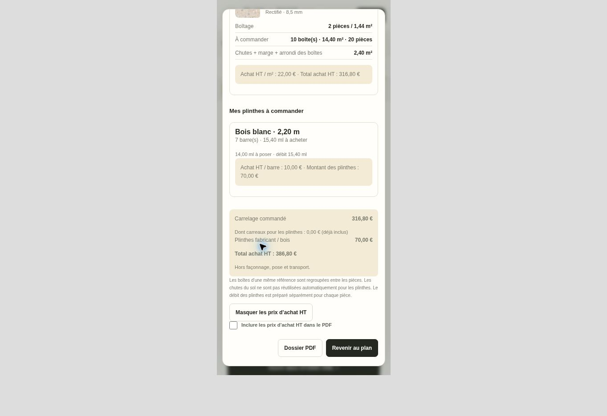

# Chiffrage des plinthes et tarif Shell - 23 octobre 2026

## Prix vérifiés

La grille ELIOS TARIF NETS 2026 V01, page 1, comporte une ligne « 60 x 120 cretta Sedimenti Shell Spat » à 22,00 €. Le prix standard lisse/R11 60 x 120 à 15,00 € ne doit pas être appliqué à cette ligne Shell. La grille ne sépare pas Matt et Saten : les deux références Shell 60 x 120 reprennent 22,00 € HT/m², avec une note explicite. Aucun supplément Saten par rapport à Matt n'est déduit du document.

La même page donne les plinthes à la pièce : 6,5 x 100 à 5,60 €, 6,5 x 120 poli à 9,00 €, 6,5 x 120 / 6 x 120,5 à 7,50 €, 6,5 x 60 / 61 / 90 à 3,00 €, 7,5 x 40,5 à 2,00 €. Les dimensions sont associées exactement : les formats voisins non cités restent sans prix automatique. 86 des 114 références de plinthes disposent ainsi d'un montant. Shell Beige 04FBT11 : 7,50 € HT/pièce, boîte de 8 pièces, soit 60,00 € HT/boîte.

Source : document fabricant original retrouvé dans l'historique autorisé du dépôt, commit 5bc656f06882f5f1475ceb86f9400be9e07c99b6, ancien chemin assets/pdf/elios2026.pdf, SHA-256 `9100c3bc4df5f49c442754f1bb28b9a3106c4bf779f477ceae091439e32d35a0`. Le PDF retiré du site public n'est pas restauré ni republié. Les accès aux tarifs sécurisés restent ceux du site existant.

## Bilan et achats

- Le coût matière des carreaux réservés aux plinthes est détaillé comme déjà inclus dans la commande de carrelage, sans l'ajouter une seconde fois.
- Le prix des plinthes fabricant porte sur les pièces réellement achetées, après regroupement et arrondi des boîtes.
- Le bois blanc est chiffré par barre de 2,20 m, au prix saisi pour le projet. Aucun tarif bois n'est inventé ; un prix absent donne un sous-total explicitement incomplet.
- Les achats restent masqués au démarrage, y compris les champs de prix des plinthes. Le PDF n'inclut les achats que sur choix explicite.
- Les anciens projets reprennent le nouveau tarif catalogue. Un prix d'achat explicitement personnalisé est conservé.
- Le prix matière exclut le façonnage, la pose et le transport.

Les données et calculs sont repris dans PLAN & POSE, RANDAL Général et STUDIO ONE, dont les relevés CSV précisent le montant des plinthes et leur inclusion éventuelle.

## Contrôles

61 tests Node passent. Scénario DOM sur l'application réelle : reprise d'un projet à 15 -> 22 HT/m², conservation d'un tarif manuel, prix fabricant par pièce, bois sans prix puis chiffré, bilan, masquage et PDF. Chrome : Shell Saten 04F6A13 à 22 HT/m² ; plinthes découpées incluses une seule fois, puis fabricant et bois. Pour une pièce test de 4 x 3 m avec bois à 10 HT/barre : 7 barres, 70 HT de plinthes, total 386,80 HT.

Deux PDF de contrôle de trois pages, avec et sans achats, ont été générés, leurs textes vérifiés et la dernière page rendue inspectée. Le regroupement des trois pièces tests donne 1 013,76 HT de carrelage + 250 HT de plinthes séparées = 1 263,76 HT, dont 47,52 HT de carreaux réservés aux plinthes déjà inclus.

Builds Général et Studio réussis ; les 7 vérifications Général et les contrôles du contrôleur Studio passent. Les assets 3D inchangés ne font pas l'objet d'une nouvelle validation visuelle GPU dans cet environnement.

