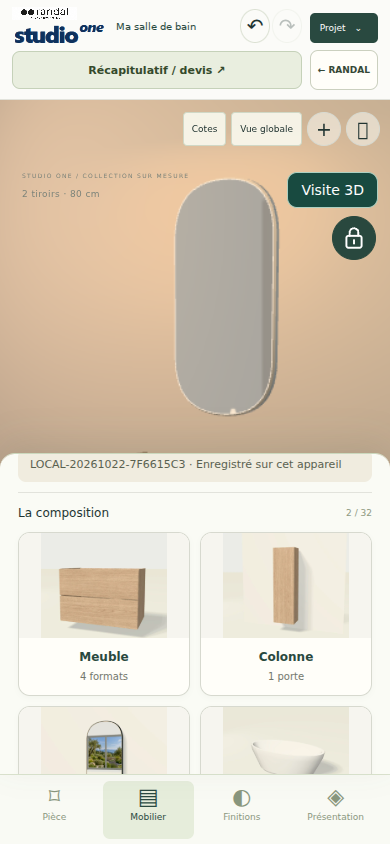
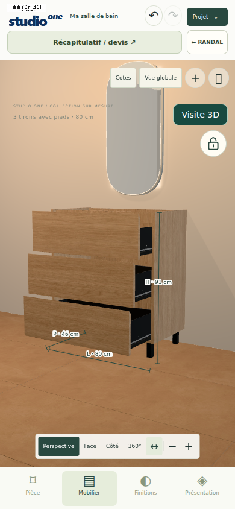
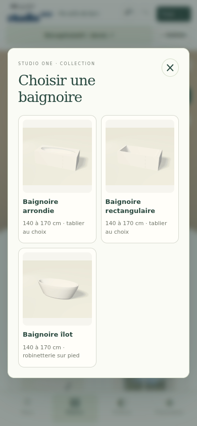

# RANDAL — finitions, quincaillerie et interface

Corrections du 22 octobre 2026, STUDIO ONE et catalogue Général.

## Changements visibles

- Avatar retiré ; le verrou de composition occupe son ancien emplacement sous « Visite 3D ». La visite à la première personne reste disponible.
- « Implantation & calepinage » apparaît uniquement dans Pièce, plus dans Mobilier.
- Catégories et fenêtres de choix illustrées par des vues des modèles 3D existants : fenêtre, porte, trois baignoires distinctes, douche, deux parois, WC, lave-mains, sèche-serviettes, robinetteries et six miroirs.
- 28 images WebP de 600 × 500 pixels, environ 235 Ko au total. Les photos fabricant fiables des meubles STUDIO ONE sont conservées. Les nouvelles vues sont des rendus de modèles, pas des photographies fabricant. La provenance et les empreintes sont dans `dist/assets/product-visuals/v2/sources.json` de chaque moteur.

## Pieds du trois tiroirs et métal intérieur

Référence reçue de Juan Carlos : mail « Pied meuble STUDIO ONE 3 TIROIRS. (noir) », pièce jointe `ALBUFERA_CB_NG.jpg`, conservée dans les ressources fabricant de STUDIO ONE.

Le document montre le même pied en chrome et en noir. Seule la version noire est intégrée : quatre supports carrés, patins et platines triangulaires percées. Hauteur totale d'un pied : 10 cm. Le caisson de 81 cm et la hauteur totale du meuble de 91 cm sont préservés. Les proportions horizontales et la platine suivent la photographie ; le document ne fournit pas de plan coté permettant d'affirmer leurs dimensions industrielles exactes.

Fonds, flancs, dos et contre-façades des tiroirs : métal anthracite `#34383b`, métallicité 0,65, rugosité 0,44. Application aux formats STUDIO ONE et Général sans modification des façades, des dimensions, des références commerciales ou des prix.

## Collections et coloris proposés

Le filtre porte sur le carrelage, indépendamment de la peinture. Après contrôle : **30 collections et 136 coloris proposés**, **44 collections et 227 coloris retirés des nouveaux choix**.

| Motif | Coloris masqués |
|---|---:|
| Aucune face fabricant exploitable | 115 |
| Définition source insuffisante | 91 |
| Azuli Mood : faces livrées de 47 à 56 pixels malgré les métadonnées | 11 |
| Glow/Washington : image vide encadrée | 1 |
| Skultura : photographies de relief déjà éclairées | 7 |
| Amalfi et Eden : décors exclus par la charte du dépôt | 2 |
| **Total** | **227** |

La règle de définition utilise la source d'origine, jamais un agrandissement : grand côté d'au moins 700 pixels et au moins 150 000 pixels de surface, avec exclusions visuelles explicites. L'inventaire détaillé avec chaque collection, chaque coloris et le motif se trouve dans `qa/surface-selection-audit.json` de chaque moteur.

Les définitions et fichiers d'origine sont conservés pour relire les anciens projets. Une finition retirée déjà enregistrée reste identique et est signalée comme « référence enregistrée ». Elle n'est pas remplacée silencieusement. Les nouveaux choix et les zones de rénovation utilisent le catalogue filtré. Les finitions des plans prédéfinis, dont Shell Beige et Creta Avena, restent disponibles.

## Validation

- Construction de production réussie pour les deux moteurs (`npm run build`).
- STUDIO ONE : suite `npm run check` et contrôle supplémentaire `qa/controls-check.mjs` réussis, dont 27 variantes du trois tiroirs et les quatre formats.
- Général : suite `npm run check` réussie, dont 16 formats de meubles et les références fabricant.
- Contrôles de qualité et capture HD réussis : chargement, conservation du projet, restauration du niveau de travail après succès ou erreur, clics multiples et budgets de sortie.
- STUDIO ONE : parcours navigateur réussi sur ordinateur et mobile émulé : 12 catégories, images décodées, ajout des objets, verrouillage effectif, section réservée à Pièce, restauration de Mysterium/Acqua et Brooklyn/white sans changement de finition ; aucune erreur JavaScript ou requête manquante.
- Général : même parcours navigateur réussi sur ordinateur et mobile émulé, sans erreur JavaScript ni requête ou image manquante. Les colonnes Aras et Boreal partagent légitimement leur vue : mêmes dimensions, finition, poignée et géométrie.
- Les contrôles navigateur des interactions et de la présentation utilisent Chromium, en 1440 × 900 et en émulation mobile 390 × 844 ; il ne s'agit pas d'un essai sur un téléphone physique.

Les moteurs paramétriques existants, leurs dimensions, leurs projets enregistrés et les niveaux de qualité sont conservés. Ce rapport décrit le code et sa validation ; la publication effective doit être associée au commit servi par Vercel, et ne se déduit pas de la seule présence du code sur GitHub.

## Publication STUDIO ONE vérifiée

Le déploiement Vercel `dpl_GSzudBEe1RUFHytVtXj5w3UBG14w` est READY et sert le commit `6c7eb4075457cb14da920f061bd4fa287961bebc` sur l'alias public `studio-one-beta-test-v2.vercel.app` ; son script porte l'empreinte `b0e7a075e426`.

Contrôle réel via la page Leroy Factory et son iframe : moteur prêt, Avatar absent, verrouillage effectif, trois images distinctes de baignoires chargées en 600 × 500, aucune erreur JavaScript et aucune requête ou image manquante.

Une correction supplémentaire du seul texte d'aide mobile de la visite retire la référence résiduelle à Avatar dans le commit `1b3e47f0ab750938e08d5ba2bab2339c01ff321e`. Sa publication a été refusée par Vercel : HTTP 402, `api-deployments-free-per-day`, limite de 100 déploiements par jour, réessai annoncé après 86 400 secondes. Toutes les corrections visibles demandées pour STUDIO ONE sont incluses dans le déploiement READY précédent.

## Publication Général bloquée

Le code et les tests de Général sont enregistrés sur `main` dans le commit `cd905d838be6a335634f2307d43eeaa667c60f79`. La tentative de déploiement en production du projet `randal-catalogue-general-3d` a été refusée : HTTP 402, `api-deployments-free-per-day`, plus de 100 déploiements par jour, réessai annoncé après 86 400 secondes. La recherche des déploiements de ce commit ne retourne aucun résultat. Ces nouvelles corrections de Général ne sont donc pas encore en ligne. Aucun changement de facturation ou de formule Vercel n'a été effectué.

## Captures de contrôle mobile

Captures du navigateur local en émulation 390 × 844.

Nouveaux visuels et verrou de composition :

Trois tiroirs ouverts, intérieurs anthracite et pieds noirs de 10 cm :

Choix des trois baignoires avec leurs images distinctes :

